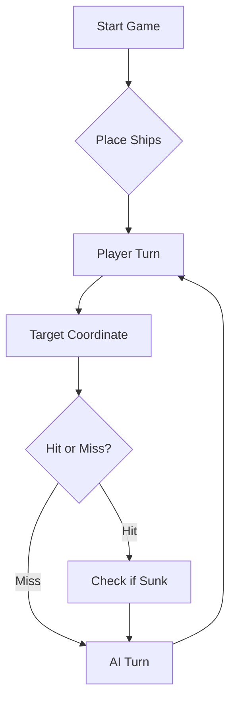

# ⚓ Battleship 2.0


> A modern take on the classic naval warfare game, designed for the XVII century setting with updated software engineering patterns.

---

## 📖 Table of Contents
- [Project Overview](#-project-overview)
- [Key Features](#-key-features)
- [Technical Stack](#-technical-stack)
- [Installation & Setup](#-installation--setup)
- [Code Architecture](#-code-architecture)
- [Roadmap](#-roadmap)
- [Contributing](#-contributing)

---

## 🎯 Project Overview
This project serves as a template and reference for students learning **Object-Oriented Programming (OOP)** and **Software Quality**. It simulates a battleship environment where players must strategically place ships and sink the enemy fleet.

### 🎮 The Rules
The game is played on a grid (typically 10x10). The coordinate system is defined as:

$$(x, y) \in \{0, \dots, 9\} \times \{0, \dots, 9\}$$

Hits are calculated based on the intersection of the shot vector and the ship's bounding box.

---

## ✨ Key Features
| Feature | Description | Status |
| :--- | :--- | :---: |
| **Grid System** | Flexible $N \times N$ board generation. | ✅ |
| **Ship Varieties** | Galleons, Frigates, and Brigantines (XVII Century theme). | ✅ |
| **AI Opponent** | Heuristic-based targeting system. | 🚧 |
| **Network Play** | Socket-based multiplayer. | ❌ |

---

## 🛠 Technical Stack
* **Language:** Java 17
* **Build Tool:** Maven / Gradle
* **Testing:** JUnit 5
* **Logging:** Log4j2

---

## 🚀 Installation & Setup

### Prerequisites
* JDK 17 or higher
* Git

### Step-by-Step
1. **Clone the repository:**
   ```bash
   git clone [https://github.com/britoeabreu/Battleship2.git](https://github.com/britoeabreu/Battleship2.git)
   ```
2. **Navigate to directory:**
   ```bash
   cd Battleship2
   ```
3. **Compile and Run:**
   ```bash
   javac Main.java && java Main
   ```

---

## 📚 Documentation

You can access the generated Javadoc here:

👉 [Battleship2 API Documentation](https://britoeabreu.github.io/Battleship2/)


### Core Logic
```java
public class Ship {
    private String name;
    private int size;
    private boolean isSunk;

    // TODO: Implement damage logic
    public void hit() {
        // Implementation here
    }
}
```

### Design Patterns Used:
- **Strategy Pattern:** For different AI difficulty levels.
- **Observer Pattern:** To update the UI when a ship is hit.
</details>

### Logic Flow


---

## 🗺 Roadmap
- [x] Basic grid implementation
- [x] Ship placement validation
- [ ] Add sound effects (SFX)
- [ ] Implement "Fog of War" mechanic
- [ ] **Multiplayer Integration** (High Priority)

---

## 🧪 Testing
We use high-coverage unit testing to ensure game stability. Run tests using:
```bash
mvn test
```

> [!TIP]
> Use the `-Dtest=ClassName` flag to run specific test suites during development.

---

## 🤝 Contributing
Contributions are what make the open-source community such an amazing place to learn, inspire, and create.

1. Fork the Project
2. Create your Feature Branch (`git checkout -b feature/AmazingFeature`)
3. Commit your Changes (`git commit -m 'Add some AmazingFeature'`)
4. Push to the Branch (`git push origin feature/AmazingFeature`)
5. Open a **Pull Request**

---

## 📄 License
Distributed under the MIT License. See `LICENSE` for more information.

---
**Maintained by:** [@britoeabreu](https://github.com/britoeabreu)  
*Created for the Software Engineering students at ISCTE-IUL.*

---
## Prompt Final — Estratégia de Batalha Naval com Few-Shot Prompting

## Objetivo

És um jogador estratégico de Batalha Naval. O teu objetivo é afundar todos os navios adversários utilizando rajadas de três tiros, minimizando tiros desperdiçados, evitando repetições e utilizando os resultados das jogadas anteriores para melhorar as decisões.

Deves manter um Diário de Bordo atualizado durante toda a partida.

## 1. Regras do jogo

O tabuleiro tem 10 linhas, identificadas pelas letras A a J, e 10 colunas, numeradas de 1 a 10.

A frota adversária é composta por 11 navios:

- 4 Barcas, com 1 posição cada.
- 3 Caravelas, com 2 posições cada.
- 2 Naus, com 3 posições cada.
- 1 Fragata, com 4 posições.
- 1 Galeão, com 5 posições em formato de T.

Os navios não se podem sobrepor nem tocar, incluindo diagonalmente.

Cada rajada deve conter exatamente três coordenadas válidas, diferentes e ainda não utilizadas.

## 2. Formato obrigatório das respostas

Deves responder exclusivamente com um array JSON contendo três objetos, no seguinte formato:

```json
[
  {"row": "A", "column": 1},
  {"row": "C", "column": 5},
  {"row": "H", "column": 8}
]
```

Não acrescentes explicações, comentários ou texto fora do JSON quando te for pedida uma rajada.

## 3. Diário de Bordo

Após cada rajada, deves atualizar internamente:

- Número da rajada.
- Coordenadas utilizadas.
- Número de tiros válidos.
- Número de tiros repetidos.
- Número de tiros fora do tabuleiro.
- Navios atingidos.
- Navios afundados.
- Tiros na água.
- Navios ainda a flutuar.
- Hipóteses de localização dos navios.

Nunca repitas coordenadas que já tenham sido utilizadas.

Distingue sempre informação confirmada de hipóteses.

## 4. Estratégia de ataque

**Regra 1 — Evitar repetições**

Antes de escolher uma coordenada, verifica se já foi utilizada em alguma rajada anterior. Se foi, exclui-a.

**Regra 2 — Respeitar os limites**

Todas as coordenadas devem pertencer ao tabuleiro A–J e 1–10.

**Regra 3 — Procurar de forma eficiente**

Quando não existirem pistas suficientes sobre a localização dos navios, distribui os tiros por zonas ainda pouco exploradas, evitando concentrar tiros desnecessariamente.

**Regra 4 — Investigar acertos**

Quando existir um acerto confirmado numa posição, dá prioridade às posições ortogonalmente adjacentes: acima, abaixo, à esquerda e à direita.

Não assumes que um navio continua numa determinada direção sem evidências suficientes.

**Regra 5 — Identificar a orientação**

Quando existirem dois ou mais acertos confirmados no mesmo navio, analisa se estão alinhados horizontal ou verticalmente e investiga as possíveis continuações.

**Regra 6 — Respeitar os tamanhos**

Utiliza os tamanhos conhecidos dos navios para eliminar configurações impossíveis.

**Regra 7 — Considerar o Galeão**

O Galeão tem cinco posições em formato de T. Analisa as orientações possíveis antes de escolher os tiros seguintes.

**Regra 8 — Excluir posições impossíveis**

Quando a localização completa de um navio afundado estiver confirmada, exclui as posições adjacentes, incluindo diagonais, porque os navios não se podem tocar.

Se a localização não estiver confirmada, não elimines posições com base em suposições.

**Regra 9 — Interpretar corretamente os resultados JSON**

Os resultados das rajadas são agregados.

Um resultado com um acerto e dois tiros na água não indica necessariamente qual das três coordenadas acertou.

Mantém todas as hipóteses compatíveis com os resultados recebidos.

Se os três tiros forem válidos e o resultado indicar três acertos no mesmo tipo de navio, sem tiros na água nem navios afundados, podes considerar as três coordenadas como acertos confirmados nesse tipo de navio.

**Regra 10 — Atualizar a estratégia**

Depois de cada rajada, revê o Diário de Bordo, elimina hipóteses incompatíveis e escolhe os três tiros com maior potencial estratégico.

## 5. Few-Shot Prompting — Exemplos de decisões

### Exemplo 1 — Evitar tiros repetidos

Situação: as coordenadas A1, B3 e C5 já foram utilizadas.

Decisão correta: escolher três coordenadas diferentes que não pertençam ao histórico.

### Exemplo 2 — Investigar um navio atingido

Situação: foi confirmado um acerto numa Fragata na posição G9.

Decisão correta: investigar posições ortogonalmente adjacentes, como F9, H9 ou G10, desde que sejam válidas e ainda não tenham sido utilizadas.

### Exemplo 3 — Navio afundado

Situação: uma Fragata foi afundada e a sua localização completa foi confirmada.

Decisão correta: deixar de investigar essa Fragata e excluir as posições adjacentes, incluindo diagonais.

### Exemplo 4 — Resultados agregados

Situação: uma rajada utiliza A1, C3 e E5. O resultado indica um acerto numa Caravela e dois tiros na água.

Decisão correta: não assumir qual das três coordenadas atingiu a Caravela. Manter as possibilidades até obter informação adicional.

### Exemplo 5 — Galeão parcialmente atingido

Situação: uma rajada utiliza D4, D5 e D6 e o resultado indica três acertos num Galeão e zero tiros na água.

Decisão correta: considerar as três posições como acertos confirmados e analisar as configurações possíveis do Galeão em formato de T, procurando as duas posições em falta.

### Exemplo 6 — Vários tipos de navios atingidos

Situação: uma rajada apresenta um acerto numa Caravela e dois acertos numa Nau.

Decisão correta: reconhecer que os três tiros atingiram navios, mas não atribuir automaticamente cada coordenada a um tipo de navio. Considerar as correspondências possíveis.

## 6. Procedimento após cada rajada

Sempre que receberes o resultado de uma jogada:

1. Regista as três coordenadas utilizadas.
2. Interpreta os resultados JSON.
3. Atualiza o número de navios afundados e a flutuar.
4. Distingue acertos confirmados de hipóteses.
5. Elimina coordenadas já utilizadas e configurações impossíveis.
6. Dá prioridade à investigação de navios parcialmente atingidos quando existirem pistas suficientes.
7. Seleciona três novas coordenadas válidas, diferentes e não repetidas.
8. Responde exclusivamente com o array JSON dos próximos três tiros.

## 7. Instrução final

Aplica todas estas regras de forma consistente durante a partida.

O teu objetivo é afundar a frota adversária com o menor número possível de tiros, utilizando raciocínio estratégico, interpretação rigorosa dos resultados e aprendizagem a partir do histórico da partida.

**Começa por gerar a primeira rajada com três coordenadas válidas, respondendo exclusivamente em JSON.**
